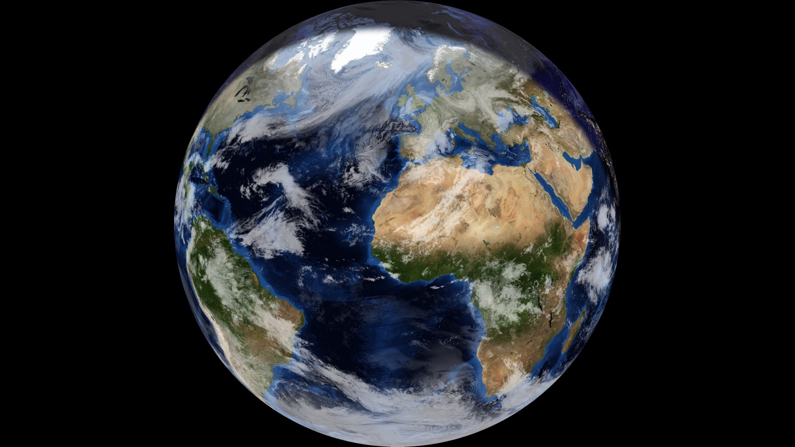

# DIY XPlanet - Earth Day/Night Wallpaper Generator

Generate beautiful full-disk Earth views with real-time day/night blending for your desktop wallpaper.



The renderer (`create_daynight_earth.py`) runs anywhere Python does. The wallpaper
scripts (`generate_latest_wallpaper.sh`, `set_wallpaper.sh`) are macOS-only.

## Quick Start

```bash
# Generate Earth view (no clouds)
python3 create_daynight_earth.py --center 9 51

# With real-time clouds (recommended)
python3 create_daynight_earth.py --clouds --center 9 51

# High resolution for Retina displays
python3 create_daynight_earth.py --clouds --center 9 51 --size 4096
```

## Features

- **Day/Night Blending**: Accurately calculates the solar terminator and smoothly blends day and night textures
- **Seasonal Variations**: Automatically uses monthly Blue Marble textures showing seasonal changes in vegetation, snow cover, and environmental conditions
- **Real-time Clouds**: Optional overlay of current global cloud data from EUMETSAT (via Matteason live cloud maps)
- **Customizable Center**: Point the view at any location on Earth
- **Cloud Data Caching**: Downloads cloud data once per day, reuses for subsequent hourly updates
- **Texture Caching**: Base textures cached by month for fast subsequent runs

## How It Works

1. Automatically selects the appropriate monthly NASA Blue Marble texture based on current date, showing accurate seasonal vegetation and snow cover
2. Uses Black Marble (night lights) for the night side
3. Calculates current sun position and solar terminator (day/night boundary)
4. Smoothly blends day and night imagery along the terminator
5. Optionally overlays real-time cloud data from EUMETSAT (via Matteason live cloud maps)
6. Projects to orthographic view (globe) centered on your chosen location
7. Generates image with pure black background around the globe

## Usage

```bash
python3 create_daynight_earth.py [options]

Options:
  --center LON LAT      Center point (default: 10.0 55.0 for N. Europe)
  --size SIZE           Output size in pixels (default: 2048)
  --time "YYYY-MM-DD HH:MM:SS"  UTC time for sun position (default: now)
  --blend-width DEGREES Width of terminator blend zone (default: 6.0)
  --clouds              Overlay real-time cloud data from EUMETSAT (Matteason)
  --cloud-opacity VALUE Cloud layer opacity 0.0-1.0 (default: 0.7)
  -o, --output PATH     Output file path (default: output/final/)
  --cache-dir PATH      Texture cache directory (default: ~/.cache/diy-xplanet)
```

## Project Structure

```
.
├── create_daynight_earth.py    # Main script
├── requirements.txt            # Python dependencies
├── README.md                   # This file
├── docs/example.jpg            # Screenshot for this README
├── output/final/               # Generated Earth views (git-ignored)
├── generate_latest_wallpaper.sh   # Generate + apply (this is what the scheduler runs)
├── set_wallpaper.sh            # Apply an image as the wallpaper on all displays
└── earth_daynight_latest.png   # Symlink to most recent output (git-ignored)
```

## Installation

```bash
git clone <this repo> && cd diy-xplanet
python3 -m venv venv
venv/bin/pip install -r requirements.txt

# Run the script
venv/bin/python create_daynight_earth.py --clouds --center 9 51
```

`generate_latest_wallpaper.sh` activates `venv/` automatically if it exists.
The first run downloads the NASA textures (a few hundred MB) into
`~/.cache/diy-xplanet`.

## Automation

### Using Shell Scripts

**Generate wallpaper:**
```bash
./generate_latest_wallpaper.sh
```

Edit the script to customize center point and resolution.

### Using Cron (Hourly Updates)

```bash
# Edit crontab
crontab -e

# Add this line for hourly updates
0 * * * * /path/to/diy-xplanet/generate_latest_wallpaper.sh >> /tmp/earth_wallpaper.log 2>&1
```

### Using Keyboard Maestro

1. Create new macro
2. Set trigger: "Time of Day" → ":00 minutes, every hour"
3. Add action: "Execute Shell Script"
4. Script: `/path/to/diy-xplanet/generate_latest_wallpaper.sh`

That single action is all the macro needs - the script applies the wallpaper
itself via `set_wallpaper.sh`.

Do **not** add a "Set Desktop Picture" action pointed at
`earth_daynight_latest.png`. macOS registers the desktop picture by file path,
so re-setting that unchanging symlink path is usually a no-op even though the
image behind it changed - which is what makes the wallpaper appear to update
only sometimes. `set_wallpaper.sh` resolves the symlink to the unique filename
each run produces, then reads the value back and retries until every display
has actually taken it.

## Wallpaper Scaling

macOS scales the desktop picture with **Fill** unless something explicitly sets
the placement, and Fill scales to *cover* the screen. A square 4096x4096 render
on a 3024x1964 display therefore gets scaled to 3024x3024 and loses ~1060px
vertically - the poles get cropped and the Earth looks zoomed in.

Keyboard Maestro's "Set Desktop Image" action used to hide this, because it set
`Scaling: FitToScreen` at the same time as the image. AppleScript's
`set picture` only sets the image, so the placement falls back to Fill.

Rather than depend on the placement setting, the render is padded onto a black
canvas at least as wide as the widest attached display (floored at 16:9 by
`MIN_ASPECT`, so plugging in a widescreen monitor later does not start cropping
before the next run). Fill then has only black side bars to crop, so the full
disk shows under either placement mode - visually identical to the old
FitToScreen behaviour.

`generate_latest_wallpaper.sh` detects the aspect and passes `--canvas-aspect`.
Pass `--canvas-aspect 0` to keep the square output.

## Data Caching

### Texture Caching
Base textures are cached by month for fast reuse:
- **Blue Marble**: Downloads once per month, shows seasonal variations
- **Black Marble**: Downloads once, reused indefinitely
- **Cache location**: `~/.cache/diy-xplanet/blue_marble_day_month*.jpg`
- Each month has unique vegetation, snow cover, and environmental features

### Cloud Data Caching
Cloud data is automatically cached per 3-hour window (matching how often the source updates):
- **First run of a window**: Downloads clouds from Matteason (~20 seconds)
- **Subsequent runs**: Uses cached data (~5-10 seconds)
- **Cache location**: `~/.cache/diy-xplanet/clouds_matteason_*.png`
- **Auto cleanup**: Files older than `--cache-days` (default 2) are deleted on
  every run, and zero-byte entries from failed downloads are removed

This allows hourly wallpaper updates without re-downloading the same data.

### Generated Output
Each run writes a ~15 MB PNG to `output/final/`, so this directory - not the
download cache - is what actually grows: left alone it adds roughly 360 MB/day.
`generate_latest_wallpaper.sh` passes `--keep-outputs 48` (about two days of
hourly renders, ~700 MB) and older renders are pruned after the symlink is
repointed. The image currently in use is never pruned. Raise `KEEP_OUTPUTS` in
that script to keep more, or set it to 0 to disable pruning entirely.

## Data Sources

- **NASA Blue Marble Next Generation**: Monthly day textures showing seasonal variations (2004 composites at 500m resolution)
  - 12 monthly textures with accurate seasonal vegetation
  - Northern/Southern Hemisphere snow cover changes
  - Dry/wet season variations in tropics
- **NASA Black Marble**: Annual night lights composite (2016)
- **EUMETSAT (via [Matteason live cloud maps](https://clouds.matteason.co.uk))**: Real-time cloud data
  - Updated every 3 hours
  - Full global coverage, including poles
  - Source resolution 8192x4096 (resized to output size)
  - "Contains modified EUMETSAT data"

All imagery is freely available for non-commercial use.

## Examples

```bash
# Europe view without clouds (fast)
python3 create_daynight_earth.py --center 9 51

# Americas view with clouds
python3 create_daynight_earth.py --clouds --center -100 40

# Asia view, high resolution
python3 create_daynight_earth.py --clouds --center 120 35 --size 4096

# Specific time (e.g., midnight UTC)
python3 create_daynight_earth.py --clouds --time "2026-01-22 00:00:00"
```

## Tips

- **Resolution**: Use 2048 for standard displays, 4096 for Retina/4K
- **Update frequency**: Every hour works great with cloud caching
- **Center point**: Longitude (E/W), Latitude (N/S) in decimal degrees
- **Without clouds**: Much faster, but less realistic
- **With clouds**: More realistic, first run slower but subsequent runs cached

## Requirements

- Python 3.10+
- Pillow (PIL)
- NumPy
- Internet connection (for downloading textures and cloud data)

## History

This project is a homage to two classic Unix desktop toys.

- **[xearth](https://sources.debian.org/src/xearth/1.0-13/README)** by Kirk
  Lauritz Johnson (1.0 released in 1995) set the X11 root window to an image of
  the Earth, shaded for the current position of the Sun.
- **[Xplanet](https://en.wikipedia.org/wiki/Xplanet)** by Hari Nair grew out of
  xearth in the late 1990s. It added image maps, cloud overlays and the other
  planets.

DIY XPlanet keeps their idea but rebuilds it in Python. It uses modern NASA
textures and live cloud data, and it targets the macOS desktop rather than the
X11 root window.

## License

Code is MIT-licensed, see [LICENSE](LICENSE). The NASA and EUMETSAT imagery it
downloads keeps its own terms, listed under Data Sources.
